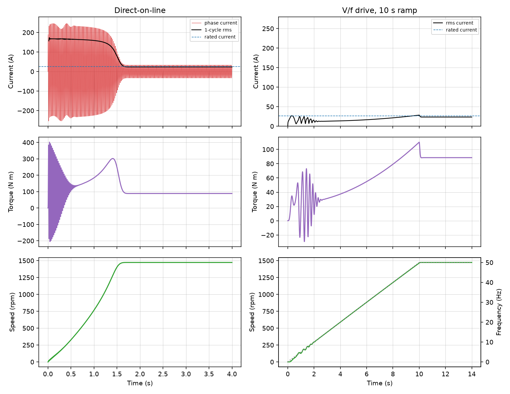
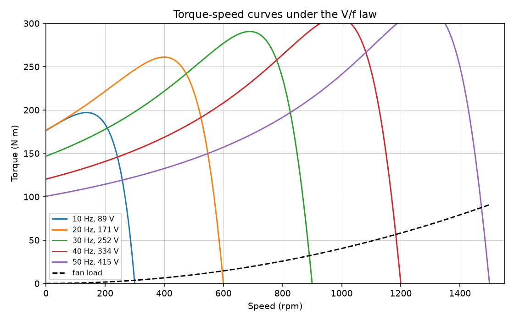
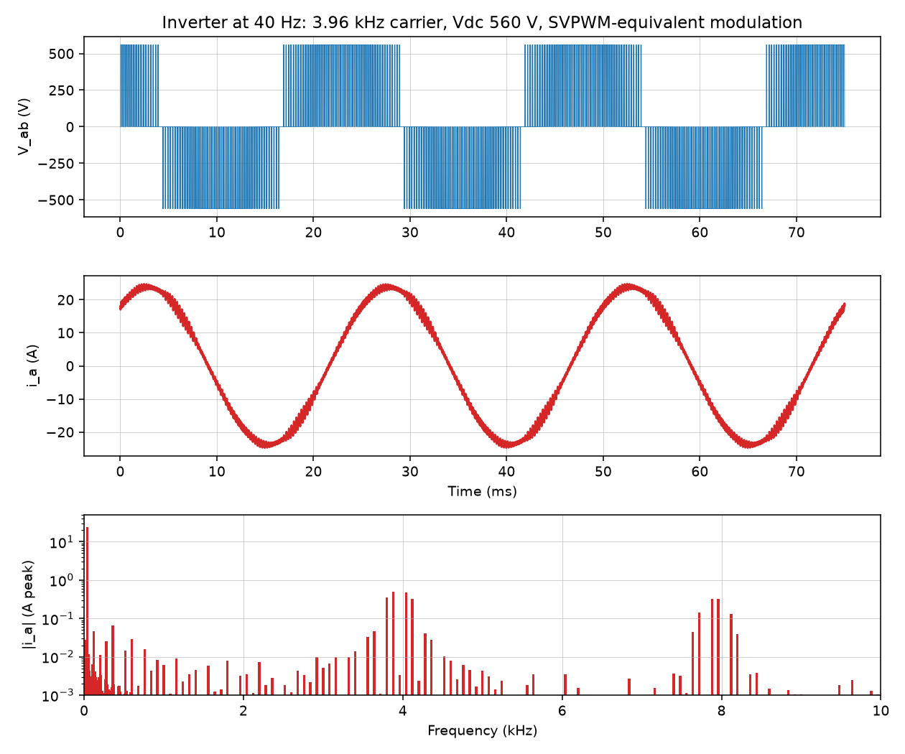
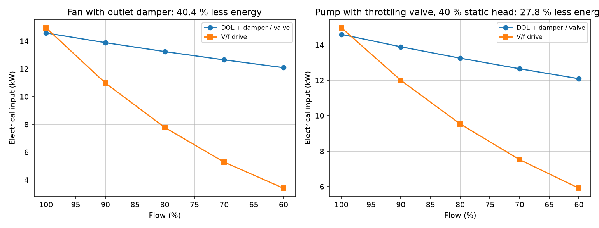

# VFD Speed Control of an Induction Motor: V/f Control & Energy Analysis

A 15 kW, 415 V, 4-pole induction motor driving a fan, studied three ways:

1. **Starting**: direct-on-line against an open-loop V/f drive with a 10 s ramp,
   using a dynamic dq model of the motor and fan.
2. **Inverter waveforms**: a switching-level model of a two-level PWM inverter
   (sine-triangle with space-vector-equivalent zero-sequence injection) feeding
   the motor, with current and voltage spectra.
3. **Energy**: a year of variable-flow operation, comparing the motor on the
   mains with a damper or throttling valve against the same motor on the drive.
   Both a fan and a pump with static head are covered.

## Running

```bash
pip install -r requirements.txt
python study.py
python -m pytest
```

Plots and `vfd_study.xlsx` are written to `results/`.

## Motor

| | |
|---|---|
| Equivalent circuit | Rs 0.25 Ohm, Rr' 0.20 Ohm, Lls = Llr 2.2 mH, Lm 70 mH, Rc 574 Ohm |
| Rated point | 15 kW, 97.4 N m, 1469 rpm, 26.1 A, pf 0.865, efficiency 92.4 % |
| Locked rotor at 415 V | 167 A, 6.4 x rated |
| Fan duty point | 13.5 kW at 1473 rpm, 23.9 A |
| Inertia, motor + impeller | 1.5 kg m2 |

The parameters were chosen so the motor matches a typical IE3 15 kW 4-pole
nameplate.

## 1. Starting: DOL vs V/f

| | Direct-on-line | V/f drive, 10 s ramp |
|---|---|---|
| Maximum current (1-cycle rms) | 173.6 A = **6.65 x rated** | 28.5 A = **1.09 x rated** |
| First-cycle peak (with DC offset) | 253 A = 9.7 x rated rms | - |
| Peak air-gap torque | 402 N m (oscillating, 4 x rated) | 110 N m |
| Time to 98 % speed | 1.55 s | 9.85 s (follows the ramp) |



- **On DOL** the motor draws locked-rotor current for most of its run-up. The
  first cycles carry a DC offset (253 A peak), and the torque oscillates at
  supply frequency up to 4 x rated, which the coupling and fan shaft see on every
  start.
- **The drive** raises frequency and voltage together (V/f with an 8 V boost for
  the stator IR drop). The motor works near its rated slip throughout, and current
  never exceeds 1.09 x rated. The supply sees no starting dip, and the mechanical
  shock is gone.
- The small oscillation below about 5 Hz on the V/f start is real behaviour of
  open-loop V/f at low frequency: the rotor flux mode is lightly damped there.
  It dies out as frequency rises. Slip compensation or vector control would
  remove it.



## 2. Inverter waveforms at 40 Hz

| | |
|---|---|
| DC bus | 560 V (diode rectifier, 1.35 x 415 V) |
| Carrier | 3.96 kHz, synchronous, mf = 99 |
| Modulation | sine-triangle plus min-max zero-sequence injection (linear up to Vdc / sqrt(3)) |
| Fundamental line voltage | 332.7 V rms (V/f command 333.6 V) |
| Motor current | 16.8 A rms fundamental, **THD 4.2 %** |
| Line voltage THD | 63 % (PWM pulses; the motor's leakage inductance filters them) |

The carrier is an odd multiple of 3 times the output frequency. A first version
used exactly 4 kHz, which is 100 x 40 Hz: an even ratio that breaks half-wave
symmetry and left a 0.9 A DC component in the motor current. With mf = 99 the
current is symmetric, and the ripple shows up as sidebands around 4 and 8 kHz.



## 3. Energy over a year

6000 h/year, flow profile: 100 % for 10 % of the time, 90 % for 20 %, 80 % for 30 %,
70 % for 25 %, 60 % for 15 %. Electricity at INR 8/kWh.

| Application | Damper / valve, mains motor | V/f drive | Saving |
|---|---|---|---|
| Fan, outlet damper | 79 117 kWh | 47 132 kWh | **40.4 %**, 31 985 kWh, INR 2.56 lakh |
| Pump, throttling valve, 40 % static head | 79 117 kWh | 57 140 kWh | **27.8 %**, 21 977 kWh, INR 1.76 lakh |

Fan, by flow:

| Flow | Damper: shaft / input kW | Drive: speed, frequency | Drive: shaft / input kW |
|---|---|---|---|
| 100 % | 13.5 / 14.6 | 100 %, 50.0 Hz | 13.5 / 15.0 |
| 90 % | 12.9 / 13.9 | 90 %, 44.9 Hz | 9.8 / 11.0 |
| 80 % | 12.3 / 13.3 | 80 %, 39.8 Hz | 6.9 / 7.8 |
| 70 % | 11.7 / 12.7 | 70 %, 34.8 Hz | 4.6 / 5.3 |
| 60 % | 11.2 / 12.1 | 60 %, 29.8 Hz | 2.9 / 3.4 |



- The saving comes from **speed control replacing throttling**, not from the
  starter. A damper holds the fan at full speed and burns the excess pressure,
  so shaft power falls only from 13.5 to 11.2 kW between 100 % and 60 % flow. On
  the drive the fan follows the affinity laws: 60 % flow needs 60 % speed and
  about 22 % power.
- At full flow the drive costs slightly more (its own 2.5 % loss), so the case
  rests on part-load hours.
- A pump lifting against **static head** cannot slow down as far: at 60 % flow it
  still needs 75 % speed. The saving drops to 28 %. Quoting fan-law savings for a
  pump with significant static head overstates them.
- Motor efficiency at each drive operating point comes from the equivalent
  circuit at that frequency and voltage, including core and friction losses.
  It falls from 93 % to 89 % at the lowest speed, and the drive's efficiency is
  modelled as 96-97.5 % depending on load.

## Model notes

- **Dynamic model**: 5th-order dq model in the frame of the supply voltage
  vector (stator and rotor flux linkages plus speed), integrated with RK45.
  Core loss is left out of the dynamic model, which is why its steady current
  comes out about 1 % below the equivalent circuit.
- **Load**: fan torque proportional to speed squared, plus windage.
- **Inverter**: ideal switches, no dead time. The DC bus is stiff and the motor
  speed is held constant over the short switching window.
- **Fan and pump curves** in per unit: head `1.25 - 0.25 Q^2` at full speed,
  efficiency `eta_bep (2x - x^2)` around the best-efficiency point, system curve
  `h_static + (1 - h_static) Q^2`.

## Layout

```
vfd/motor.py    equivalent circuit, V/f law, dynamic dq model
vfd/pwm.py      switching inverter + motor, spectra and THD
vfd/energy.py   fan / pump curves and annual energy
study.py        runs everything, writes results/
```
